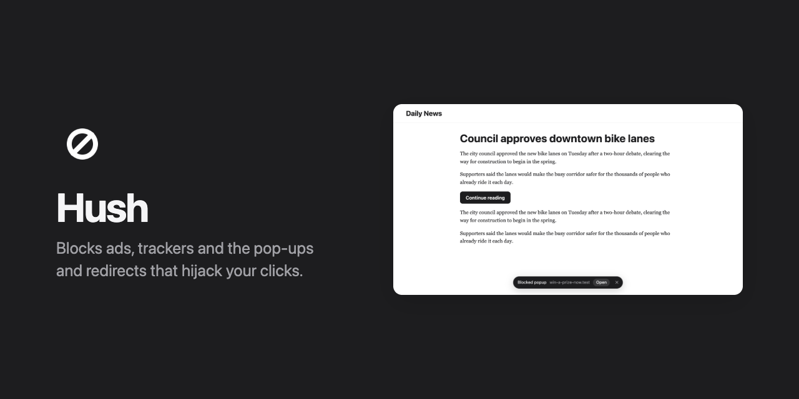
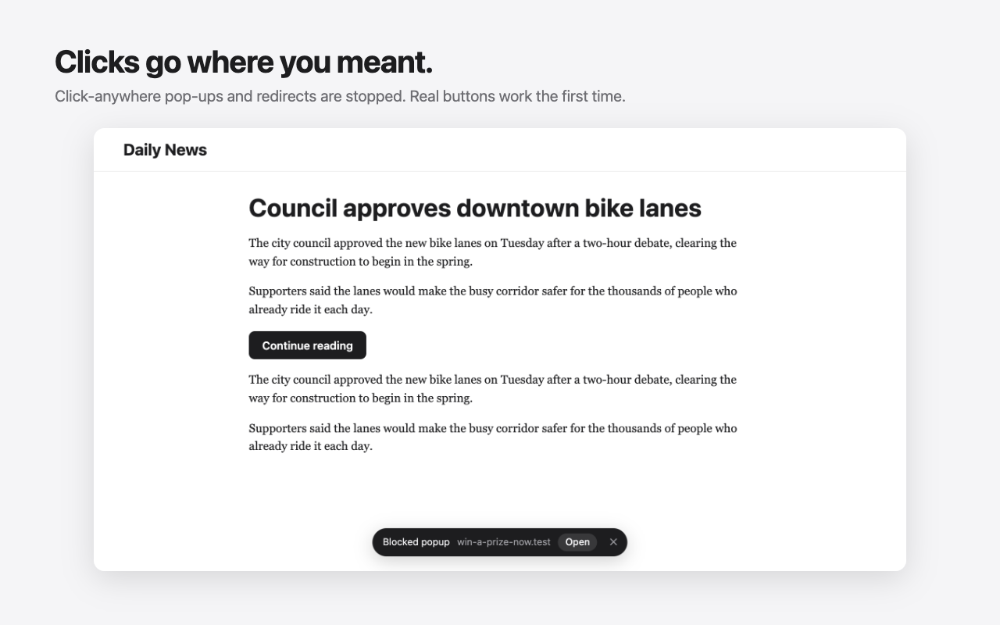
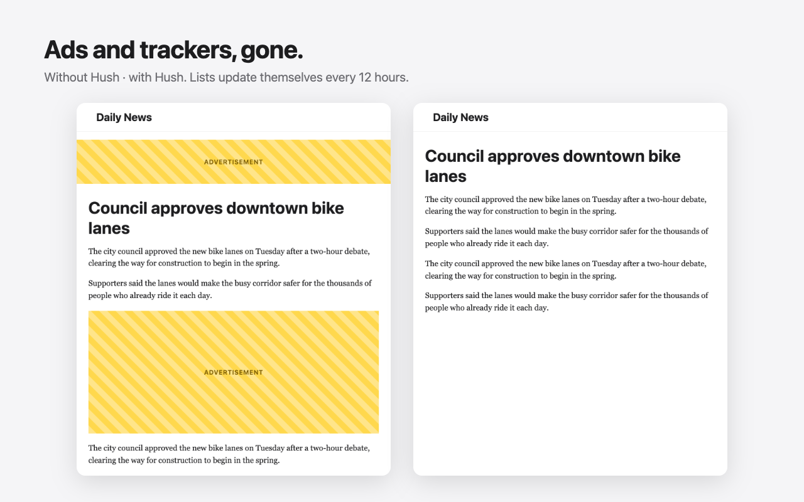
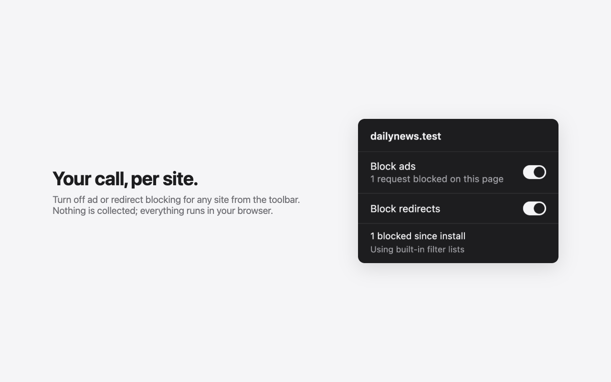

<p align="center">
  
</p>

<p align="center">
  <b>The ad blocker that also stops click hijacking.</b><br>
  Click anywhere on a page and nothing opens. Click a real button and it works the first time.
</p>

<p align="center">
  <a href="https://github.com/jappabl/hush-adblocker/releases/latest/download/hush.zip"></a>
  &nbsp;
  <a href="https://github.com/jappabl/hush-adblocker/releases/latest"></a>
  &nbsp;
  
  &nbsp;
  
</p>

---

You know the sites. You click a blank part of the page and a new tab opens to a casino. You click **Download** and land on a "your phone is infected" page. You click a real button and nothing happens, because the first click was eaten by an invisible ad layer, so you click again.

Every ad blocker stops ads. **Hush also stops the click hijacking**, and hands your click to the button you were aiming at, so it works the first time.

## How it stacks up

Measured head to head, each competitor in its strongest setting (uBlock Origin Lite in Complete mode, AdGuard and Brave Shields with their advanced protection on, Adblock Plus as installed).

**Real sites that hijack clicks** (popunder-heavy converters, torrent search, ad-network test pages; 10 hijacked visits)

| | Visits with no stray tab or redirect | Site's own link worked on the first click |
|---|:---:|:---:|
| **Hush** | **10 / 10** | **6 / 6** |
| uBlock Origin Lite | 10 / 10 | 4 / 4 |
| AdGuard | 10 / 10 | 2 / 6 |
| Brave Shields | 9 / 10 | 4 / 4 |
| Adblock Plus | 8 / 10 | 2 / 6 |
| No blocker | 0 / 10 | 2 / 6 |

**Click-hijack test site**: 41 tricks ad networks use (invisible overlays and iframes, fake play buttons, pages wrapped in an ad link, tab-unders, link swapping, history traps, popups through forms, `document.open` and fresh iframes…), each with a real button that must work on the first click.

| | Hijacks stopped | Normal sites still working |
|---|:---:|:---:|
| **Hush** | **41 / 41** | **all** |
| AdGuard | 1 / 41 | all |
| uBlock Origin Lite · Brave Shields · Adblock Plus | 0 / 41 | all |

**Public ad-blocker tests**

| | [turtlecute](https://adblock.turtlecute.org/) | [adblock-tester](https://adblock-tester.com/) | [superadblocktest](https://superadblocktest.com/) |
|---|:---:|:---:|:---:|
| **Hush** | **130 / 132** | **100 / 100** | **456 / 482** |
| uBlock Origin Lite | 85 | 96 | 349 |
| Brave Shields | 83 | 96 | 339 |
| AdGuard | 30 | 75 | 184 |
| Adblock Plus | 31 | 75 | 175 |
| No blocker | 10 | 41 | 64 |

<details>
<summary><b>Read before quoting these numbers</b></summary>

- We built the click-hijack test site, then improved Hush until it passed. The competitors never saw it. Their protection is list-based, so they don't try to catch these tricks at all; the real-site table is the fairer one.
- Most of Hush's lead on the public tests comes from one extra filter list ([HaGeZi Pro](https://github.com/hagezi/dns-blocklists)). Given the same lists, Hush and uBlock Origin Lite block about the same.
- Full uBlock Origin on Firefox wasn't compared (it can't run in Chrome anymore).
- All of it is reproducible: `node test/bench/hostile.mjs`, `node test/bench/public.mjs`, `node test/bench/wild.mjs`.
</details>

## Install

1. **[Download hush.zip](https://github.com/jappabl/hush-adblocker/releases/latest/download/hush.zip)** and unzip it.
2. Open `chrome://extensions` (or `brave://extensions`, `edge://extensions`) and turn on **Developer mode** (top right).
3. Click **Load unpacked** and pick the unzipped folder.

That's it. Pin Hush from the puzzle-piece menu to see its counter. Filter lists keep themselves up to date; to get a new version of Hush itself, unzip the new release over the old folder and click the reload arrow on its card.

## What it does

<table>
<tr><td width="50%"></td><td width="50%"></td></tr>
</table>

**Click hijacking**
- Clicking blank space never opens a tab or sends you elsewhere. Click-anywhere scripts are caught even when your click lands on a button.
- Invisible layers, ad iframes, fake play buttons and pages wrapped in an ad link are switched off before you click.
- When a hijack still catches a click, the click is handed to what you aimed at. Links whose address a script swapped go where they pointed.
- No tab-unders, no timed scam redirects, no Back-button traps, no forwarding-link tricks (`/go?to=…`, `google.com/url?q=…`).
- Sign-in and checkout flows (Google, Microsoft, Apple, Firebase, PayPal, Klarna, bank card checks…) are recognised and left alone.
- When something is blocked, a small notice says what, with a way through if you did want it.

**Ads, trackers, malware**
- EasyList, EasyPrivacy, uBlock filters, Peter Lowe's list, HaGeZi Pro, uBlock Badware and URLhaus, refreshed every 12 hours.
- Ad slots are hidden so pages don't show gaps. YouTube video ads are removed, including the ad-blocker nag.
- Pages that retry a blocked request in a loop get slowed down so they can't pin your CPU.



**Your call, per site**
- Turn ad blocking or redirect blocking off for any site from the toolbar.
- See what was blocked on the page, and in total since you installed it.

**Private by design**
- No account, no analytics, no servers. Everything runs in your browser; the only requests Hush makes are downloading the public filter lists.

<br clear="right">

## Honest limits

- YouTube changes its ad delivery every few months; the YouTube code (`extension/youtube.js`) follows uBlock Origin's current approach and will need updates.
- A big domain list occasionally breaks a site feature. Turn off **Block ads** for that site if so.
- A site that sends you elsewhere from a page-wide click handler may show the notice; click **Go anyway**, or turn off **Block redirects** for it.
- Chrome, Brave and Edge only. Firefox and Safari would need ports.

## Build and test

```bash
npm install
npm run build        # download filter lists, regenerate extension/rules + extension/data
npm test             # 26 end-to-end checks in a real Chrome, incl. a fake YouTube
npm run package      # dist/hush-<version>.zip
```

| Command | What it checks |
|---|---|
| `node test/bench/hostile.mjs [config…]` | the click-hijack test site, against any of `none hush ubol adguard brave abp` |
| `node test/bench/public.mjs [config…]` | turtlecute, adblock-tester, superadblocktest, canyoublockit |
| `node test/bench/wild.mjs <sites-file> [config…]` | real hijack-heavy sites (run from a throwaway network) |
| `node test/bench/false-positives.mjs` | mainstream sites: every intervention there is a mistake |
| `node test/bench/breakage.mjs` | mainstream sites with vs without Hush: lost content, script errors, retry storms |
| `node test/youtube.mjs 4` | real YouTube with vs without Hush |

`node test/bench/browsers.mjs fetch` downloads the competitors for comparison.

| File | Role |
|---|---|
| `extension/guard.js` | click-hijack guard, runs in each page before any page script |
| `extension/youtube.js` | YouTube ad removal |
| `extension/content.js` | site-specific hiding, the blocked notice |
| `extension/background.js` | rules, per-site switches, popup backstop, list auto-update, lifetime totals |
| `extension/compiler.js` | filter list → Chrome rule compiler, used by the build and the auto-update |

## Credits

Hush stands on the filter lists people maintain for free: [EasyList and EasyPrivacy](https://easylist.to/) (GPLv3 / CC BY-SA), [uBlock Origin filters](https://github.com/uBlockOrigin/uAssets) (GPLv3), [Peter Lowe's list](https://pgl.yoyo.org/adservers/), [HaGeZi DNS blocklists](https://github.com/hagezi/dns-blocklists) (GPLv3) and [URLhaus / malware-filter](https://gitlab.com/malware-filter/urlhaus-filter) (CC0). The YouTube handling follows the approach of uBlock Origin's filter maintainers.

## License

[GPL-3.0](LICENSE).
